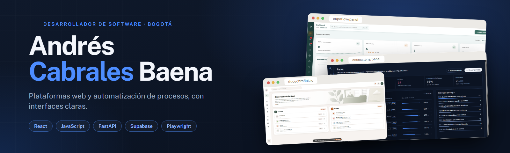
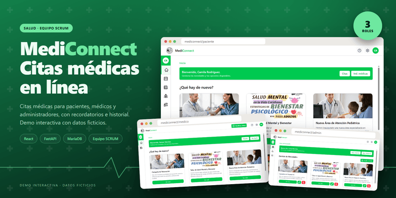
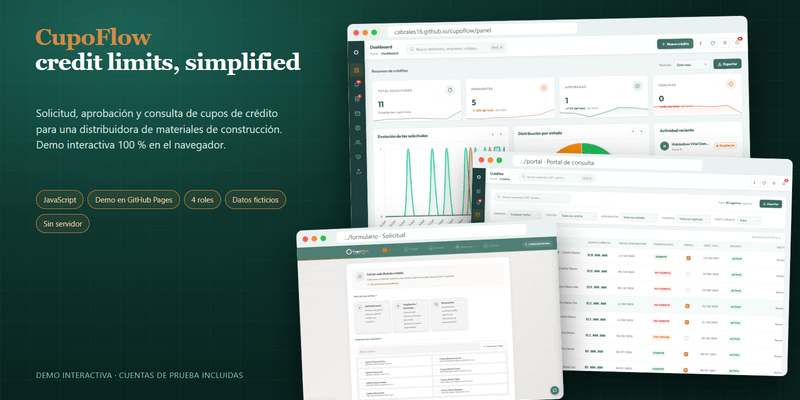
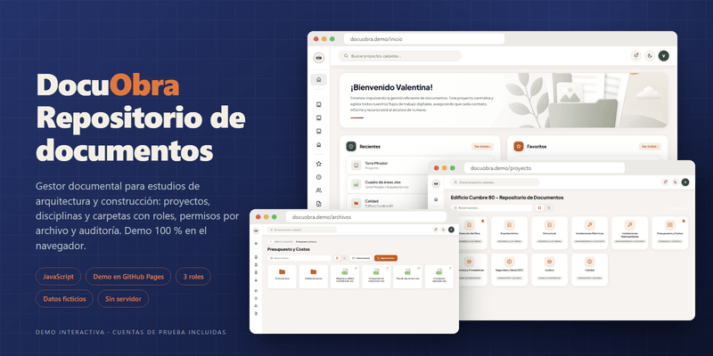
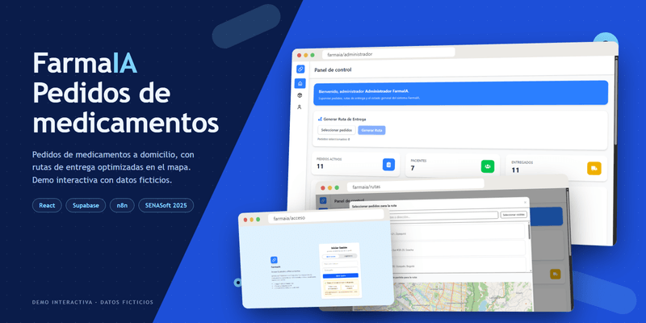
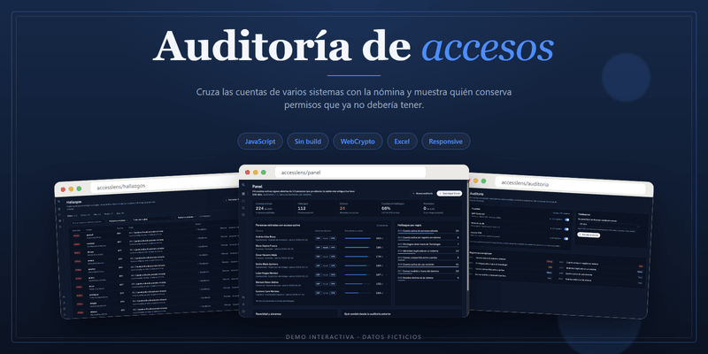
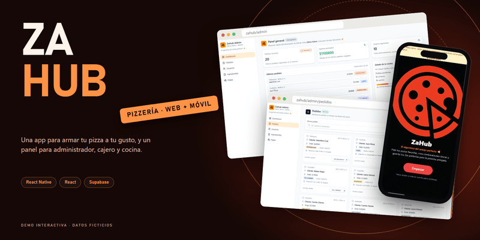
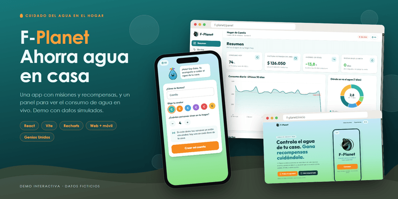

 

 

<table>
<tr>
<td width="33%" valign="top">
 
<b>Plataformas web</b> 
Paneles, formularios y portales de consulta con React, JavaScript y FastAPI.
</td>
<td width="33%" valign="top">
 
<b>Automatización</b> 
Flujos con n8n y GitHub Actions para quitar tareas repetitivas a los equipos.
</td>
<td width="33%" valign="top">
 
<b>Pruebas</b> 
Pruebas de extremo a extremo con Playwright y Selenium antes de publicar.
</td>
</tr>
</table>

<h2 align="center">Proyectos</h2>

Todos tienen demo en vivo con datos ficticios.

<table>
<tr>
<td width="50%" valign="top">
 
<b>MediConnect</b> 
Citas médicas para pacientes, médicos y administradores. 
React · FastAPI · MariaDB 

</td>
<td width="50%" valign="top">
 
<b>CupoFlow</b> 
Cupos de crédito para una distribuidora: solicitud, aprobación y consulta. 
JavaScript · Playwright 

</td>
</tr>
<tr>
<td width="50%" valign="top">
 
<b>DocuObra</b> 
Gestor documental para estudios de arquitectura, con permisos por archivo. 
JavaScript 

</td>
<td width="50%" valign="top">
 
<b>FarmaIA</b> 
Pedidos de medicamentos a domicilio, con rutas de entrega en el mapa. 
React · Supabase · n8n 

</td>
</tr>
<tr>
<td width="50%" valign="top">
 
<b>AccessLens</b> 
Auditoría de cuentas de usuario de varios sistemas contra la nómina. 
JavaScript · Sin servidor 

</td>
<td width="50%" valign="top">
 
<b>ZaHub</b> 
App para armar pizzas a gusto del cliente y panel para el equipo. 
React Native · React · Supabase 

</td>
</tr>
<tr>
<td width="50%" valign="top">
 
<b>F-Planet</b> 
Ahorro de agua en casa, con misiones y consumo en vivo. 
React · Vite · Recharts 

</td>
<td width="50%" valign="top">
 
<b>Tiendas Celeste</b> 
Tienda online de regalos con carrito y pedidos por WhatsApp. 
PHP · MySQL · Bootstrap 

</td>
</tr>
</table>

<h2 align="center">Tecnologías</h2>

Español nativo · Inglés C1

